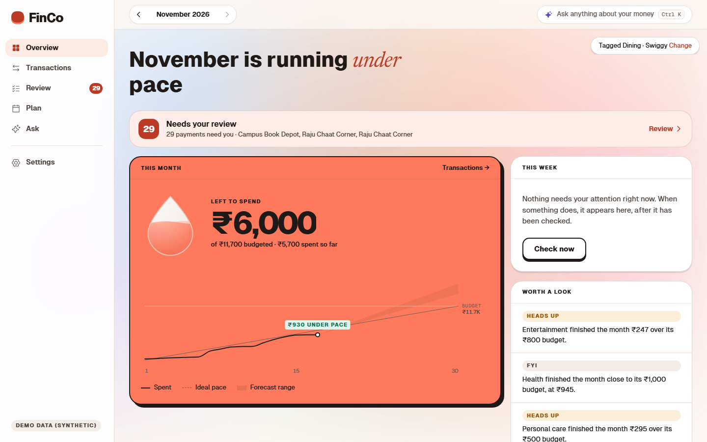
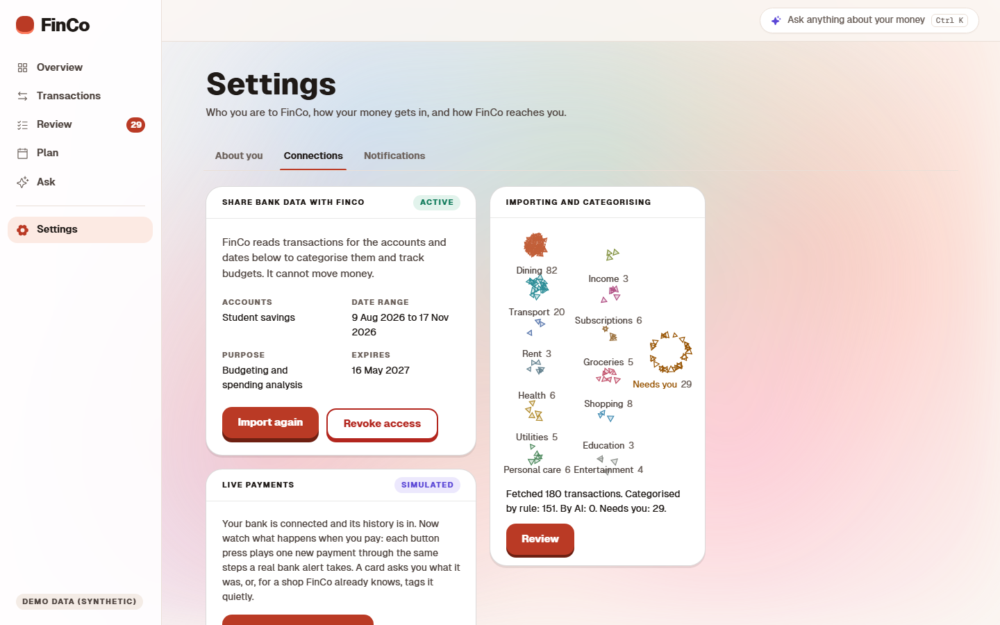
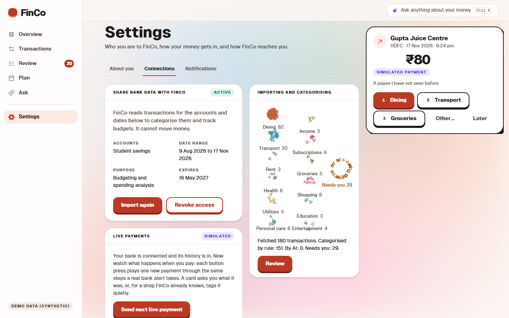
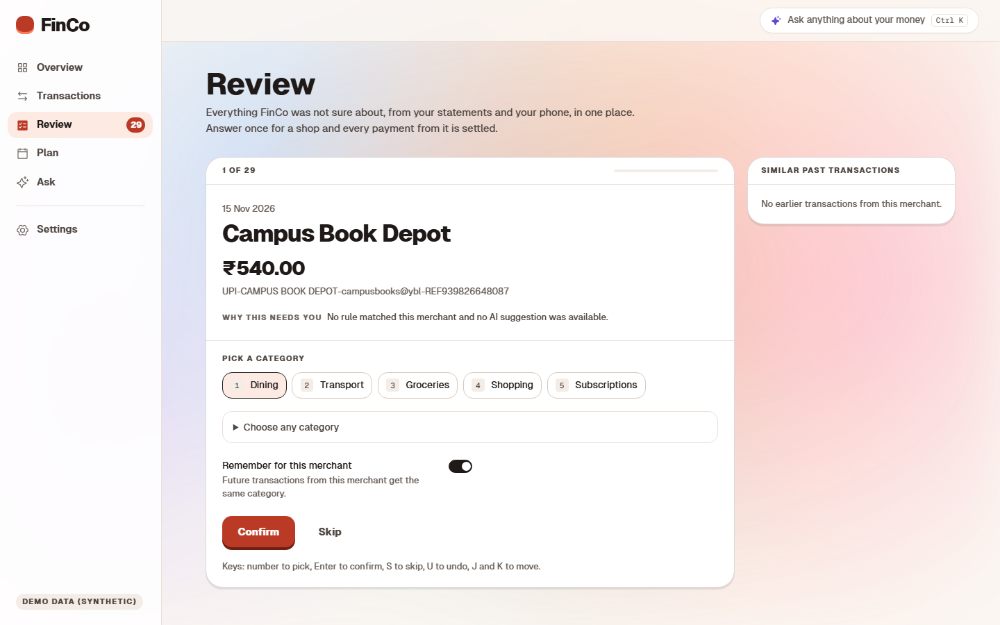
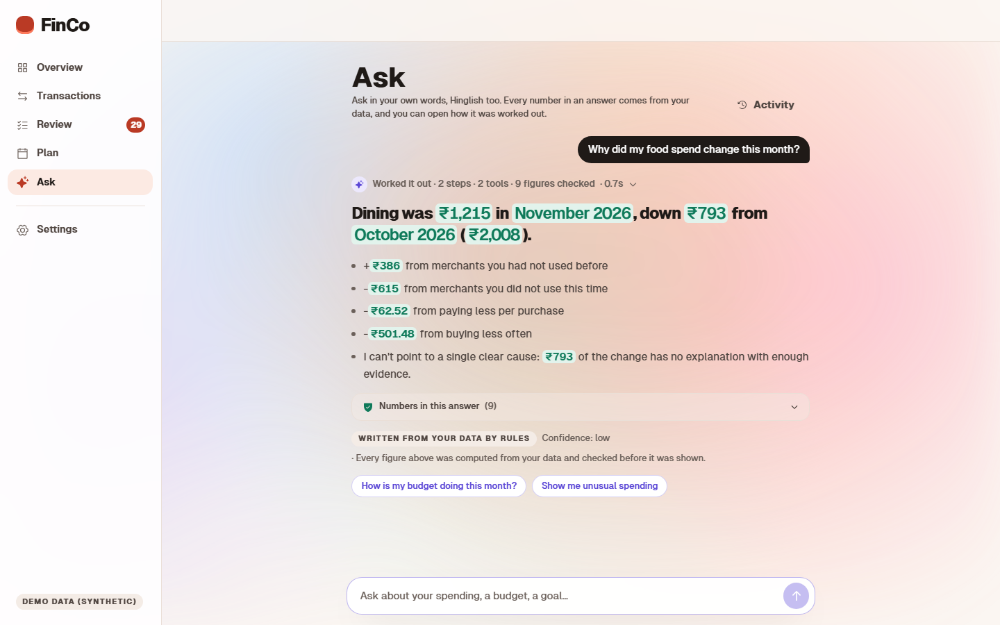
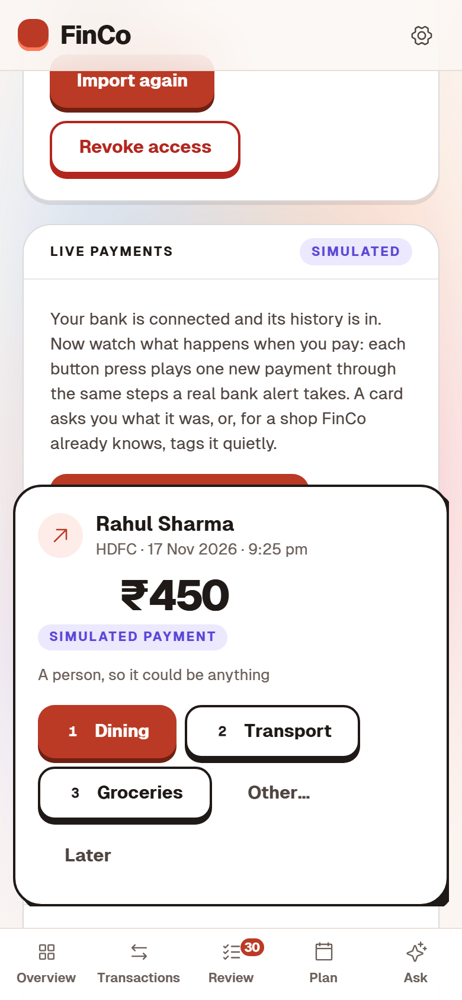
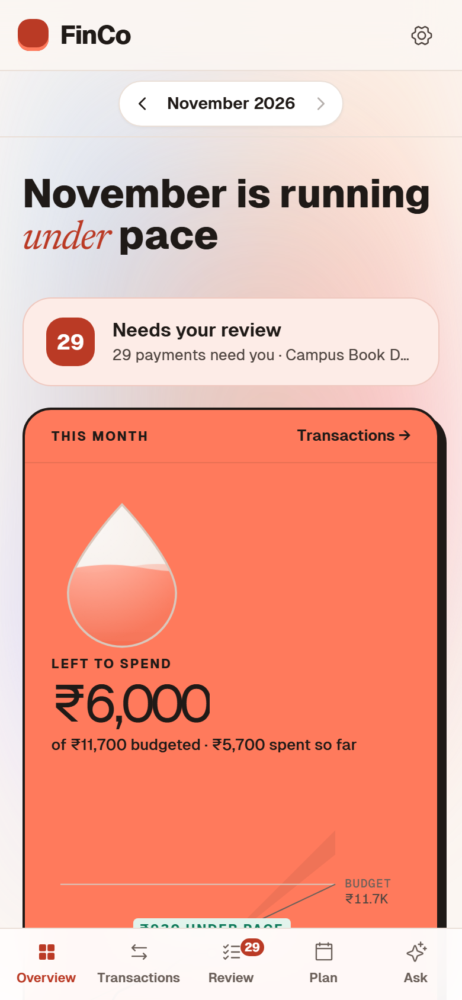
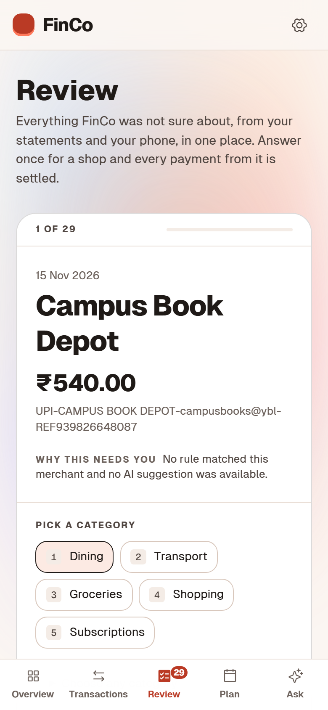
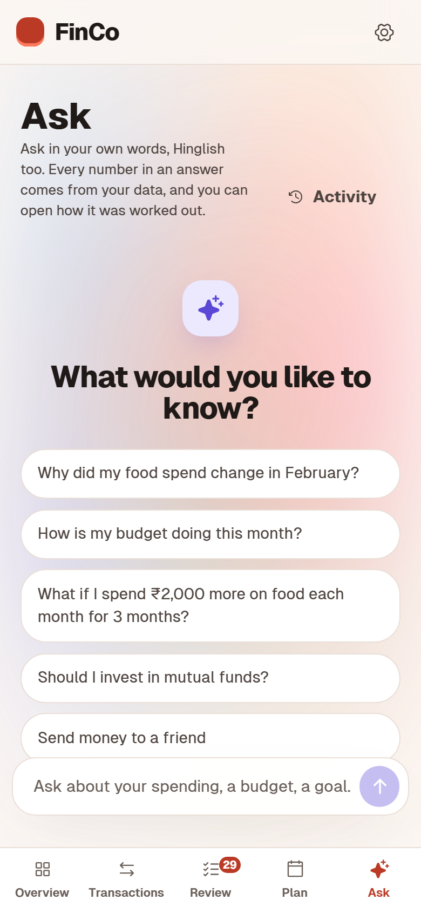
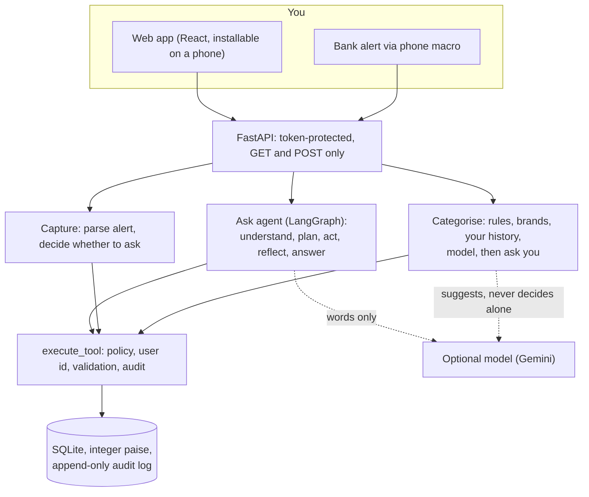

# FinCo

A personal-finance copilot for students in India. It reads your bank statements and payment alerts,
works out what each payment was for, answers questions about where your money went, and helps you
stick to a budget. It never moves money, and every number it shows is one that code computed and
checked.

<p align="center">
  
</p>

## What it does

- **Connect a bank, see your history sorted.** You approve a consent screen that says what is read
  and for how long. FinCo imports the statement and categorises it: most payments by rules and a
  brand list, the rest queued for you.
- **Tag a payment the moment it happens.** A bank alert arrives, FinCo reads it, and a card asks
  "what was this?" with three guesses and one tap to answer. A shop it already knows is tagged
  quietly, with a Change button. A person is always asked, never guessed.
- **Ask in your own words.** "Why did my food spend change this month?" is answered by an agent that
  plans, runs tools, checks its own work and shows each step as it happens. Hinglish works too.
- **Plan.** Monthly review, budgets that follow what you care about, goals, bills and subscriptions,
  and small challenges that compare you only with yourself.
- **Stay in control.** Anything consequential is a proposal that waits for your approval, every
  change is audited, and every change can be undone.

| Connect and import | A payment arrives |
| --- | --- |
|  |  |

| Review what FinCo is unsure about | Ask, with the steps shown |
| --- | --- |
|  |  |

On a phone it installs as an app and sends a notification for each payment:

<p align="center">
  
  
  
  
</p>

All screens: [docs/screenshots/](docs/screenshots/).

## How it works

Three ideas hold the whole system together. Each is enforced by tests, not just written down.

1. **Tools are the only way to touch data.** There are 155 small typed functions, each declared as
   a read or a logical write. Every call, from the API, the CLI, a planner or an agent, passes one
   gate (`execute_tool`) that checks policy, enforces the user's id and writes an audit row. No tool
   can reach outside FinCo, so nothing can pay, transfer or trade.
2. **Code does the arithmetic; a model only helps with words.** Totals, forecasts, budgets and
   what-ifs are deterministic and in integer paise. A language model may read a question, suggest a
   plan or phrase an answer, and code checks whatever it produces. With no model at all, everything
   still works from rules and templates.
3. **Agents check themselves and can say why.** You can ask "why was this tagged Dining?" or "why did
   you say that?" and get an answer from stored evidence.



The categoriser is a cascade that trusts each stage only as far as its record on your own answers:
your past choices, rules, similar shops you tagged, a brand list, a model shown your examples, and
finally a question to you. People are never labelled automatically.

The full backend map is in [src/copilot/README.md](src/copilot/README.md), with more detail in
[docs/ARCHITECTURE.md](docs/ARCHITECTURE.md).

## The agents

FinCo has eight agents, each with its own goal and trigger. Two run as LangGraph state machines with
a planner in the middle (open-ended work), one on a fixed loop (narrow, repeated work), and the rest
as deliberate pipelines that decide one payment at a time and ask you when unsure. `copilot agents`
prints this table from the code.

| Agent | Wakes on | Runs as | Goal |
| --- | --- | --- | --- |
| **ask** | a question | LangGraph graph | Answer from computed figures, never invented ones; the steps stream live |
| **multi_agent** | a question spanning areas | LangGraph graph | A supervisor splits it, specialists answer with only their own tools, a reviewer checks the merge |
| **coach** | a question | specialist | Answer about experiments, challenges and progress |
| **checkin** | a schedule | fixed kernel loop | Once in a while say the one thing that matters most, or stay quiet |
| **monthly_review** | a schedule | LangGraph graph | Write the month's review: what changed, why, what to look at |
| **categoriser** | each payment | pipeline | Give the payment a category, or ask you when not sure enough |
| **capture** | a bank alert | pipeline | Decide whether to ask right now, and what to guess |
| **runtime** | a schedule | pipeline | Run the jobs: reconcile, expire prompts, fetch, check in, learn |

## Run it

You need Python 3.11+ and Node 20+.

```bash
# Backend
python -m venv .venv
.venv\Scripts\activate            # Linux/macOS: source .venv/bin/activate
pip install -e ".[dev]"

# Frontend
cd frontend && npm install && cd ..

# Start the demo: a fresh database, the API on :8765 and the web app on :5173
npm run demo
```

Open the address it prints. The demo starts empty, so you can connect the bank and watch the
history arrive, then play new payments from Settings, Connections. No API key is needed.

To use a model for harder questions and unfamiliar shops, copy `.env.example` to `.env` and add a
Gemini key. Without one, FinCo uses rules and templates, and the numbers are the same.

On Windows, `powershell -File scripts\demo.ps1` also makes the app reachable from a phone. The
five-minute demo story, the phone setup and troubleshooting are in [docs/DEMO.md](docs/DEMO.md).

The same data is available from a terminal:

```bash
copilot seed                                # synthetic student data (3 months)
copilot consent approve consent_seed_u1_42  # nothing is read without a consent
copilot run                                 # ingest, categorise, analyse, advise
copilot ask "how is my budget doing?"       # the same agent as the Ask screen
copilot --help                              # every command
```

The terminal gives a terse answer; the web app shows the full one with its steps.

## Tests and evaluation

```bash
python -m pytest                     # backend: unit, golden, API and journey tests
cd frontend && npm run verify        # types, lint, unit tests, contrast and number checks
cd frontend && npx playwright test --project=demo     # end-to-end in a real browser
cd frontend && npm run screenshots   # regenerate docs/screenshots
copilot eval --list                  # offline evaluation suites
```

Evaluation suites declare their targets before they measure, and a missed target stays visible.
Headline results, and the checks that do not pass, are in [docs/EVALUATION.md](docs/EVALUATION.md).

## Project layout

```
src/copilot/     backend: tools, agents, categoriser, capture, planner, API, CLI
config/          policy, rules, merchant lists and thresholds, all in YAML
frontend/        React + TypeScript web app (PWA) and its tests
tests/           backend tests, a golden SMS corpus and a one-user journey test
eval/            evaluation data and simulators
scripts/         demo launcher, API schema export, and a live proof of the safety claims
docs/            architecture, demo guide, evaluation, limits, ADRs, screenshots
```

## Limits

FinCo is a working prototype. The demo bank is synthetic, the evaluations use simulated people, and
the real-bank paths (Account Aggregator, bank SMS wording) have been tested against fakes and a
small hand-written corpus, not at scale. [docs/LIMITATIONS.md](docs/LIMITATIONS.md) lists what is
known to be missing.
