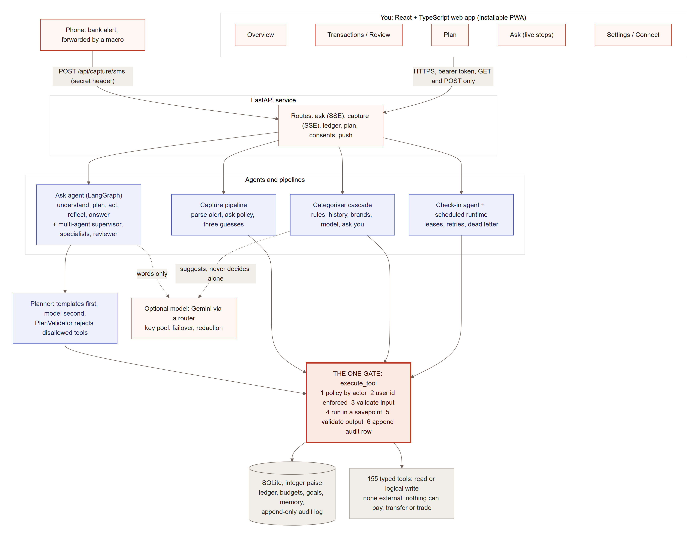
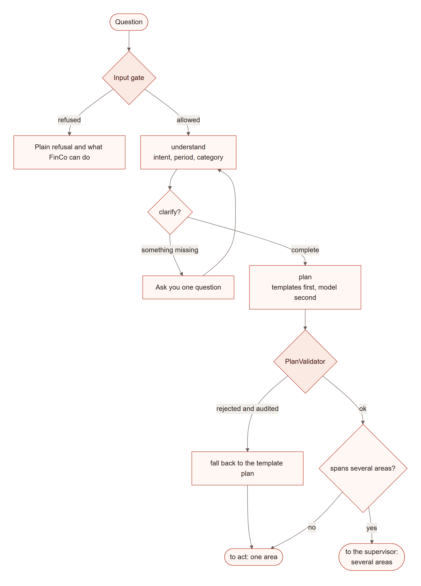
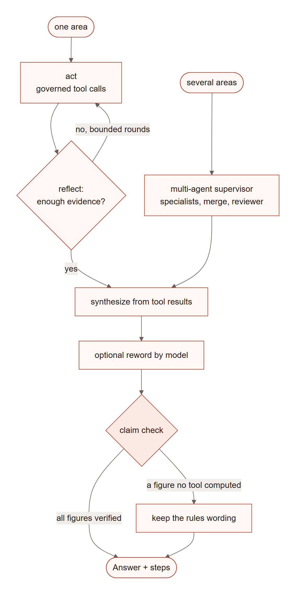
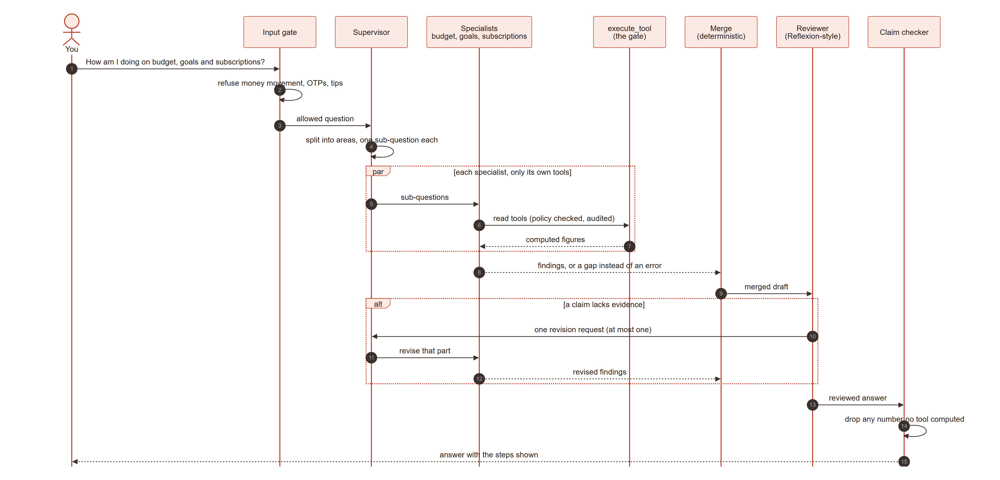
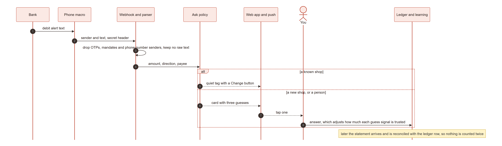
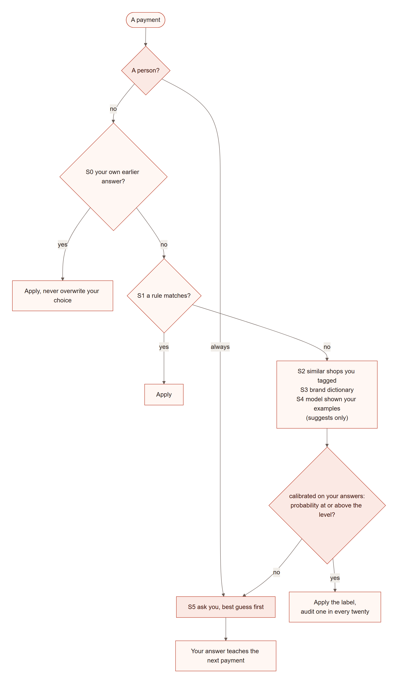

# Architecture

FinCo is a local-first web app: a Python API with a SQLite database, and a React app that talks to
it. This page explains the shape of it and the reasons behind the shape. For a package-by-package
map of the backend, read [src/copilot/README.md](../src/copilot/README.md).

## At a glance

Every path from the screen or the phone to the database passes the one gate. The diagrams in this
page are in [figures/](figures/): each `.png` has its editable Mermaid source (`.mmd`) beside it, and
can be re-rendered with any Mermaid renderer.

## The pieces

| Piece | Technology | Job |
| --- | --- | --- |
| Web app | React, TypeScript, Tailwind, Vite. Installable as a PWA | Shows figures the API computed. It never calculates money itself, and a build check fails if a literal figure appears in a screen. |
| API | FastAPI | GET and POST only. Every route except `/api/health` needs the session token. |
| Agents and graphs | LangGraph | The Ask agent, the monthly run, and a multi-agent supervisor with a reviewer. |
| Tools | Typed Python functions (155) | The only way to read or change data. |
| Store | SQLite, integer paise | Transactions, budgets, goals, memory, and an append-only audit log. |
| Model (optional) | Gemini through a router | Reads paraphrased questions, suggests plans, words answers, suggests categories. |

## The agents and their roles

Every agent is declared once in `src/copilot/agents/registry.py`, and `copilot agents` prints the list.
An agent here means something that decides on its own what to do next, using tools, toward a goal,
and checks itself before anything reaches the user.

| Agent | Autonomy and goal | Tools it may use | How it checks itself | Output |
| --- | --- | --- | --- | --- |
| **ask** | Plans and acts in a loop to answer a question from computed figures | Planner-selectable read and compute tools only | Plan validator; every figure from a tool; approval for any write | The answer, its plan and its trace |
| **multi_agent** | Splits a question across areas and merges the parts | Each specialist only its own subset | Reflexion-style reviewer, at most one revision; deterministic merge | A merged answer with findings and gaps |
| **coach** | Answers about experiments, challenges and progress | Experiment, offer, progress and goal reads | A partial answer instead of an error when a tool fails | Part of the ask answer |
| **checkin** | Acts on its own on a schedule: finds the one thing that matters, or stays quiet | Budgets, pace, renewals, goals, anomalies, cash flow; writes only its own message | Recomputes each candidate a second way; every number in the text must be computed | The For you screen, at most twice a week, never in quiet hours |
| **monthly_review** | Writes the month's review | Read tools and advice drafts | Advice validator; reviewer node | The monthly review page |
| **categoriser** | Decides each payment's category, or asks | Rules, your answers, similar shops, the brand dictionary, then one batched model request | Per-stage calibration on your own answers; a model alone never labels a payment | A ledger category, or a question in Review |
| **capture** | Decides, when an alert arrives, whether to ask now and what to guess | Record, label and reconcile payment events | Ask policy (known shop, person rule, quiet hours, daily budget); reconciliation never merges on doubt | A card or notification, then the ledger |
| **runtime** | Runs scheduled jobs | One tool per job, as the system actor | Leases so a job never runs twice at once; retries, then a dead letter | Job runs in the activity timeline |

Two loop styles exist on purpose. Open-ended work (a question may need any of many tools, in any
order) runs as a LangGraph graph with a planner in the middle. Narrow, repeated work (the weekly
check-in) runs on a fixed kernel loop: precheck, perceive, rank, verify, propose, commit. The
categoriser and the capture lane are pipelines, not free agents, because each decides one payment at
a time by calibrated confidence and a wrong silent label costs more than one question.

## One gate for everything

Whoever asks (the API, the CLI, a planner, a scheduled agent), the call goes through
`tools.executor.execute_tool`:

1. check the policy (`config/policy.yaml`) for this actor and this tool,
2. enforce the user's id so data never crosses users,
3. validate the input and the output against their types,
4. run the tool inside a savepoint,
5. write an audit row naming the actor (`user`, `agent` or `system`).

The audit table rejects updates and deletes at the database level. Tools are declared `read` or
`write_logical`; none is `external`, and the policy denies that class, so no code path can pay,
transfer, trade, withdraw or deposit. The planner is offered 49 of the tools: 47 read-only, plus two
that only do FinCo's own bookkeeping (refreshing memory candidates and rolling unspent bucket
balances over). `scripts/prove_governance.py` checks all of this live.

## Answering a question

The steps stream to the screen as they happen (`POST /api/ask/stream`), so you see the plan, each
tool, and the figure check rather than a spinner. A question that spans several areas goes to the
supervisor graph: specialists answer their part with only their own tools, a deterministic merge
combines them, and a reviewer may ask for one revision.

## Tagging a payment

A phone macro posts the alert text to the API. Any bank-style sender is read; a phone-number sender
is dropped unread. The card reaches the open app over a server-sent-events stream and, when the
app is installed on a phone, as a push notification (which needs HTTPS).

## Categorising

Each payment goes down a cascade and stops at the first stage that is confident enough:

1. your own earlier answer,
2. rules (`config/categorization_rules.yaml`),
3. shops you have already tagged that look like this one,
4. a hand-written brand dictionary,
5. a model, shown your own examples,
6. a question to you.

Every stage's confidence is calibrated against how often it has been right on *your* answers, so a
stage with a poor record is trusted less. A model only suggests: swapping in an always-wrong model
costs extra questions, not wrong labels. People are never labelled automatically.

## Why it is built this way

- **Safe by structure.** Safety does not depend on a prompt. It depends on there being no tool that
  can do harm and one gate that every call must pass.
- **Numbers you can trust.** Money is integer paise, and a claim checker removes any figure in an
  answer that a tool did not compute. A model can fail and the figures stay right.
- **Works with no model.** Every model-assisted step has a rule-based fallback, so the product
  degrades to plainer wording rather than to an error.
- **Asks when unsure.** The cost of a wrong silent label is higher than the cost of one question,
  so the system is built to ask, and to ask the question that settles the most payments first.

Decision records for the two big external choices are in [adr/](adr/): capturing at the moment of
payment, and using an Account Aggregator.
